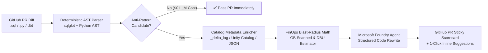

<<<<<<< HEAD
# sql-shift-left-agent
=======
<div align="center">

---

## 🚨 Why Static SQL Linters Fail Data Engineers

Traditional linters like `SQLFluff` or generic AI code review bots only see **syntax**. They have zero idea whether `orders` is a **10 MB lookup table** or a **4.2 TB Delta table partitioned by `event_date`**.

| What a Developer Commits           | What Static Linters Say   | What `sql-shift-left-agent` Catches                                                                                                                           |
| :--------------------------------- | :------------------------ | :-------------------------------------------------------------------------------------------------------------------------------------------------------------- |
| `WHERE YEAR(event_date) = 2026`  | ✅ *Valid SQL syntax!*  | 🚨 **CRITICAL:** Wrapping partition key `event_date` in `YEAR()` disables Delta partition pruning on `gold.fact_events` (**4.2 TB**).         |
| `df.filter(...).toPandas()`      | ✅ *Valid Python PEP8!* | 🚨 **CRITICAL:** Calling `.toPandas()` on unaggregated `silver.clickstream` (**850 GB**) will crash the Spark Driver with `OutOfMemoryError`. |
| `@F.udf def clean(x): ...`       | ✅ *Looks clean!*       | ⚠️ **HIGH:** Row-by-row pickled Python UDF defeats Catalyst & Photon vectorization. Rewrites into native `pyspark.sql.functions`.                     |
| `SELECT * FROM gold.fact_events` | ⚠️ *Style warning*    | ⚠️ **HIGH:** `SELECT *` on a **48-column, 4.2 TB** Delta table defeats Parquet columnar projection pushdown.                                    |

---

## 🏗️ How It Works (Zero-Cluster Architecture)



---

## 🐍 Python Version Requirements

This project is targeted at Python 3.9.x and supports Python versions `>=3.9,<3.14` as declared in [pyproject.toml](pyproject.toml). The repo is intentionally kept compatible with Python 3.9 to avoid installation issues with older local toolchains while preserving modern dependency support.

If you are using `pyenv`, install and activate a compatible interpreter before installing dependencies:

```bash
pyenv install 3.9.18
pyenv local 3.9.18
```

If you already have Python 3.9.9 or 3.9.x installed locally, you can use it directly:

```bash
poetry env use 3.9.9
poetry install --with dev --no-interaction
```

---

## ⚡ 30-Second Quickstart (Local CLI)

```bash
# 1. Install dependencies
poetry install --with dev --no-interaction

# 2. Run the test suite
poetry run pytest -q

# 3. Scan sample Spark SQL with 4.2 TB mock Lakehouse catalog (Works 100% offline!)
poetry run sql-shift-left scan examples/bad_etl_orders.sql \
  --catalog examples/mock_catalog.json

# 4. Scan sample PySpark job for Driver OOMs, Python UDFs, and missing broadcast hints
poetry run sql-shift-left scan examples/bad_pyspark_job.py \
  --catalog examples/mock_catalog.json

# 5. Generate a GitHub PR Markdown Scorecard
poetry run sql-shift-left scan examples/bad_etl_orders.sql \
  --catalog examples/mock_catalog.json --format markdown
```
>>>>>>> b8d87f8 (Initial project import)
